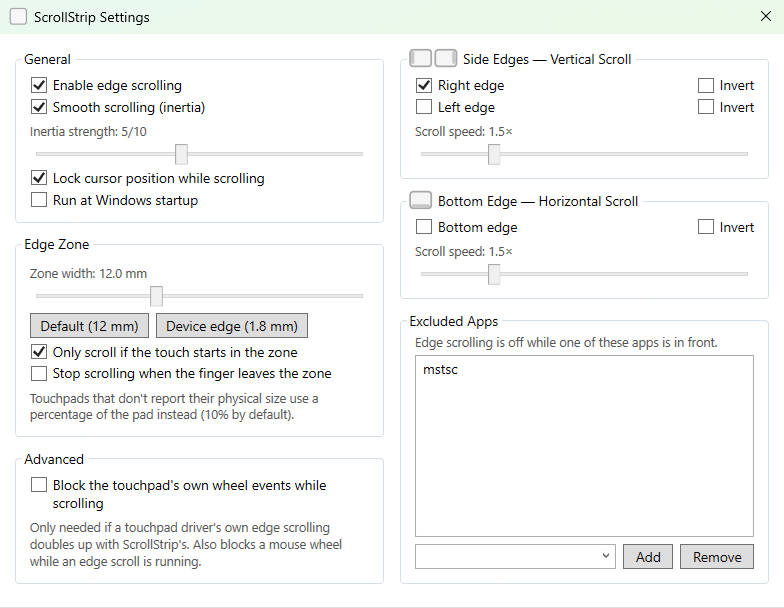
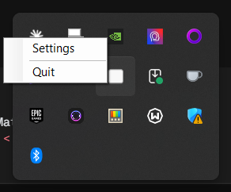

# ScrollStrip

Edge-scroll for Windows precision touchpads — swipe along the right, left or bottom edge with one finger to scroll, just like on a trackpad in Ubuntu with edge scrolling turned on, or on a Mac with Scroll.

> **Why?** Windows only supports edge scrolling for legacy (non-precision) touchpads via a driver shim. Modern precision touchpads expose a raw HID interface with no built-in edge-scroll support. ScrollStrip fills that gap without touching driver settings.

<table>
  <tr>
    <td valign="top">
      
    </td>
    <td valign="top">
      
    </td>
  </tr>
</table>

---

## Features

- **Right- and left-edge vertical scroll** — drag one finger along a side edge to scroll up/down
- **Bottom-edge horizontal scroll** — drag along the bottom edge to scroll left/right
- **Physical edge zones** — zone width is set in millimetres (default 12 mm), so it feels the same on any touchpad size; a one-click *device edge* preset (1.8 mm) gives a thin strip at the rim
- **Starts only at the edge** — a finger that lands mid-pad and slides into the strip doesn't scroll (can be turned off)
- **Momentum / inertia** — release and the page coasts; flicks coast much further, as in Scroll for macOS; adjustable strength (1–10)
- **Per-edge direction** — invert each edge independently
- **Per-axis speed multiplier** — independent speed for vertical and horizontal
- **Excluded apps** — edge scrolling switches off while a chosen app is in front
- **Firmware palm rejection** — contacts the touchpad itself flags as accidental are ignored
- **Cursor lock** — optionally pins the pointer while scrolling so it doesn't drift
- **Survives sleep** — re-registers for touchpad input on wake, and recovers from lost lift reports
- **Run at startup** — registers itself in `HKCU\...\Run` on request
- **Lives in the system tray** — no taskbar entry; double-click or right-click → Settings

---

## Requirements

| Requirement | Details |
|---|---|
| OS | Windows 10 (1903+) or Windows 11 |
| Touchpad | Any **precision touchpad** (HID Digitizer, Usage Page 0x0D / Usage 0x05) |
| Runtime | [.NET 8 Desktop Runtime](https://dotnet.microsoft.com/download/dotnet/8.0) — only needed for the framework-dependent build |

> **Check if your touchpad is a precision touchpad:** Settings → Bluetooth & devices → Touchpad. If you see "Your PC has a precision touchpad" it's supported.

---

## Installation

### Pre-built release

1. Download `ScrollStrip.exe` from the [Releases](../../releases) page.
2. Run it — a small icon appears in the system tray.
3. Right-click the tray icon → **Settings** to configure.

ScrollStrip needs no installation and writes no registry keys except the optional run-at-startup entry.

### Build from source

```
git clone https://github.com/tasos14/ScrollStrip.git
cd ScrollStrip
dotnet run --project ScrollStrip.csproj
```

To produce a self-contained single-file executable:

```
dotnet publish ScrollStrip.csproj -c Release -r win-x64 --self-contained ^
  -p:PublishSingleFile=true ^
  -p:IncludeNativeLibrariesForSelfExtract=true
```

The output lands in `bin\Release\net8.0-windows\win-x64\publish\ScrollStrip.exe`.

---

## Usage

| Action | Result |
|---|---|
| One finger on the **right edge** (or **left edge**, if enabled), drag up/down | Vertical scroll |
| One finger on the **bottom edge** (if enabled), drag left/right | Horizontal scroll |
| Release while moving | Inertia coast; a fast flick coasts much further |
| Stop, then lift | No coast |
| Touch anywhere during a coast | Stops it |
| Two fingers anywhere | Passthrough — normal two-finger gesture, no interference |
| Double-click tray icon | Opens Settings |
| Right-click tray icon → Quit | Exits |

Taps in the edge zone are intentionally ignored — a scroll only starts once the finger has travelled 2 % of the touchpad. The cursor is pinned only once scrolling has actually started, so resting a finger on the edge leaves it free.

---

## Settings

All settings are saved automatically to `%AppData%\ScrollStrip\settings.json`.

### General

| Setting | Default | Description |
|---|---|---|
| Enable edge scrolling | ✓ | Master on/off switch |
| Smooth scrolling (inertia) | ✓ | Coast after lifting the finger |
| Inertia strength | 5 | 1 (stops quickly) → 10 (long coast); 5 matches Scroll for macOS |
| Lock cursor position while scrolling | ✓ | Prevents the pointer drifting as you drag the edge |
| Run at Windows startup | ✗ | Adds/removes a registry entry under `HKCU\...\Run` |

### Edge zone

| Setting | Default | Description |
|---|---|---|
| Zone width | 12 mm | Thickness of every edge strip, 1.5–30 mm. *Device edge* sets 1.8 mm |
| Only scroll if the touch starts in the zone | ✓ | A finger sliding in from the middle of the pad doesn't scroll |
| Stop scrolling when the finger leaves the zone | ✗ | Ends the scroll, with no coast, once the finger is 2 mm past the strip |

Touchpads that don't report their physical size fall back to a percentage of the pad (10 % per edge, set in `settings.json`).

### Edges

| Setting | Default | Description |
|---|---|---|
| Right edge / Left edge | ✓ / ✗ | Vertical scroll strips, each with its own **Invert** |
| Bottom edge | ✗ | Horizontal scroll strip, with its own **Invert** |
| Scroll speed | 1.5× | Separate multipliers for vertical and horizontal |

### Excluded apps

Edge scrolling is off while one of the listed apps is in front — useful for remote desktops, VMs or games. Pick a running app from the list or type its process name (e.g. `mstsc`); case and `.exe` don't matter. UWP apps appear as `ApplicationFrameHost`.

### Advanced

| Setting | Default | Description |
|---|---|---|
| Block the touchpad's own wheel events while scrolling | ✗ | Drops wheel events ScrollStrip didn't send itself while it is scrolling, for touchpad drivers whose own edge scrolling doubles up. Also blocks a mouse wheel during an edge scroll |

`settings.json` also holds `MinStartVelocity` (default `0`, off): the speed, in touchpad lengths per second, a drag must reach before it scrolls.

---

## How it works

ScrollStrip creates a hidden message-only window and registers for **Raw Input** (`WM_INPUT`) on the precision touchpad HID device (Usage Page `0x0D`, Usage `0x05`). It never intercepts normal input — two-finger gestures, taps and clicks all reach Windows as usual.

**Reading the touchpad.** Each report is parsed with the Windows HID preparsed-data API (`HidP_GetValueCaps`, `HidP_GetUsageValue`, `HidP_GetUsages`) — without ever opening the device file — for per-finger contact ID, position, tip switch and *Confidence* (the firmware's own palm verdict). Touchpads in hybrid mode spread one scan over several reports, so reports are assembled into whole frames using the *Contact Count* field. The pad's physical size comes from the descriptor's unit fields, which is what lets zones be set in millimetres.

**Timing.** Each frame is timestamped from the HID *Scan Time* counter, cross-checked against the system clock: some firmware declares the counter but never advances it, and ScrollStrip then falls back to the wall clock rather than freezing. Velocity is only measured across at least 8 ms, because reports sometimes arrive batched a few microseconds apart.

**Scrolling.** While one confident finger drags inside a zone it started in, ScrollStrip sends `SendInput` wheel events (`MOUSEEVENTF_WHEEL` / `MOUSEEVENTF_HWHEEL`) proportional to the distance travelled, carrying fractions over so scrolling is smooth below one notch.

**Inertia** follows Scroll for macOS. On release, the finger's speed is boosted ×3 — or ×8 for a flick faster than 3.75 touchpad lengths per second — and then decays by a fixed fraction per 1/60 s on a dedicated thread driven by a high-resolution waitable timer. Both the decay and each step's distance use the real elapsed time, so timer jitter doesn't change how far a coast goes.

**Edge cases handled:**

- **Phantom multi-touch** — touchpads briefly report extra contacts within ~20 ms of a lift; a 50 ms grace keeps them from cancelling a fresh coast.
- **Tap suppression** — scrolling starts only after 2 % of the pad of travel.
- **Lost lift reports** — touchpads keep reporting about every 11 ms while a finger rests, but occasionally drop the final lift report. A contact silent for 250 ms is treated as lifted, so the cursor is never left pinned.
- **Sleep and wake** — on wake, touchpad input is re-registered and device state rebuilt; a periodic check also restores the registration if it is ever lost.

The design — including a reverse-engineering analysis of Scroll for macOS that the behaviour is modelled on — is in [docs/scroll-re-analysis.md](docs/scroll-re-analysis.md).

---

## Development

### Tests

```
dotnet test ScrollStrip.Tests
```

The tests drive the scroll recognizer, inertia, frame assembly and settings with synthetic frames, so no touchpad is needed. They never write to your real `settings.json`.

### Recording touch data

```
ScrollStrip.exe --record
```

writes every frame — contacts, timing, zone, recognizer state, emitted scroll, coast launch — to `%AppData%\ScrollStrip\record-<timestamp>.csv` for offline tuning (`--record=PATH` to choose the file). Lost contacts, sleep and wake appear as rows whose `state` starts with `!`. While recording, the tray menu has a **Show recording…** item.
